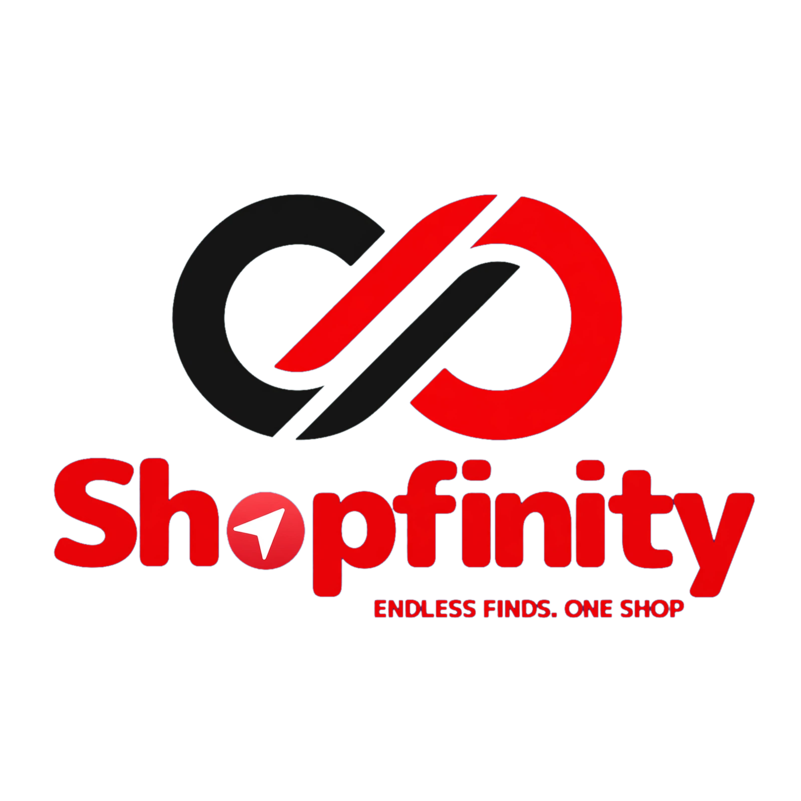

<p align="center">
  
</p>

<h1 align="center">Shopfinity — ENDLESS FINDS. ONE SHOP</h1>

<p align="center">
  A production-ready e-commerce storefront demo built with Next.js 14, TypeScript, Tailwind CSS and Zustand —
  featuring a global <strong>PHP / USD</strong> currency switcher.
</p>

<p align="center">
  <strong>Live demo:</strong> https://shopfinity-mall.vercel.app
</p>

---

## Features

- **Currency switcher (PHP / USD)** — all prices are stored in USD (`priceUSD`) and converted at `1 USD = 58.50 PHP`. PHP values render as `₱17,549.42` with an *Approx.* hint; USD renders as `$299.99`. State is global via a `CurrencyContext` backed by a Zustand store.
- **Live search** — filters products by name and category as you type.
- **Category filtering** — header pills and quick-link cards filter the product grid.
- **Wishlist** — per-product heart toggle with a live counter in the header.
- **Mock cart** — add to cart, change quantity, remove, slide-over drawer with a converted total.
- **Carousel hero** — three rotating slides with arrows and dot navigation.
- **Fully responsive** — single-column phone layout through a six-column desktop product grid.
- **Motion** — Framer Motion fade/stagger on cards and the cart drawer.

## Sections

Header (search + nav) · category pills with currency toggle · hero carousel · category quick links ·
trending products · trust badges · "Ideas for Your Next Upgrade" · deals + newsletter promo ·
footer trust row with social links.

## Tech stack

| Area | Choice |
| --- | --- |
| Framework | Next.js 14 (App Router) |
| Language | TypeScript |
| Styling | Tailwind CSS |
| State | Zustand + React Context |
| Animation | Framer Motion |
| Icons | Lucide React |
| Deploy | Vercel |

## Brand

| Token | Value |
| --- | --- |
| Primary Red | `#E30613` |
| Black | `#111111` |
| White | `#FFFFFF` |
| Light Gray | `#F5F5F5` |
| Dark Gray | `#6B7280` |

Fonts: **Poppins** (headings) and **Inter** (body).

## Getting started

```bash
npm install && npm run dev
```

Then open http://localhost:3000.

```bash
npm run build && npm start   # production build
```

## Project structure

```
app/          layout, page, global styles
components/   Header, Hero, QuickLinks, ProductCard, TrendingProducts,
              TrustBadges, Ideas, BottomPromo, Footer, CartDrawer,
              CurrencyProvider, CurrencyToggle, Price
lib/          currency helpers, product data, section content
store/        Zustand store (currency, cart, wishlist, filters)
public/       logo + generated SVG product and section artwork
```

## Notes

This is a **demo project**. Products, prices, like counts and the newsletter form are mock data —
no checkout, payment or email delivery is wired up.
